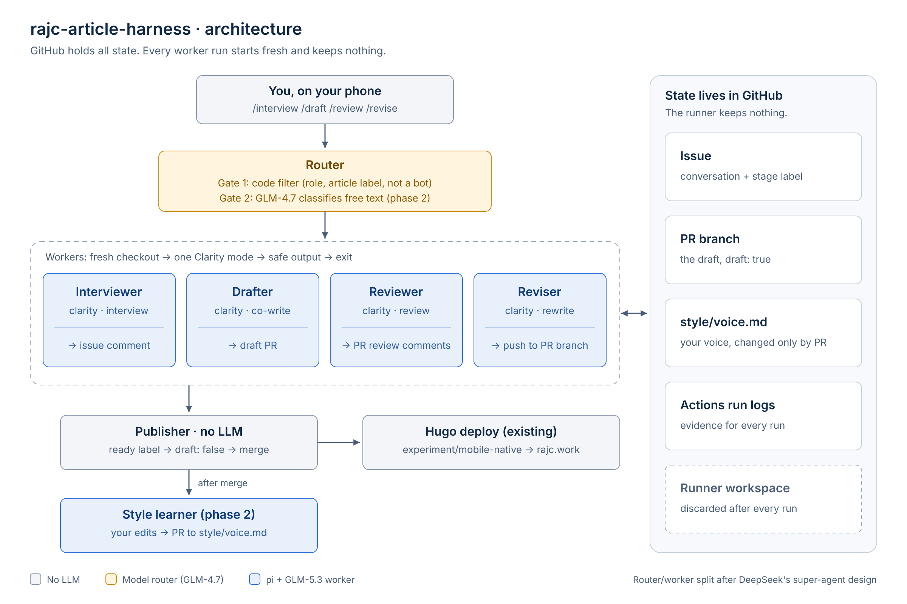
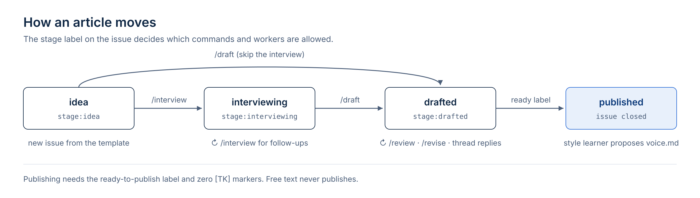

# rajc-article-harness

A small, stateless agent harness that matures [rajc.work](https://rajc.work) articles through
GitHub issues. You drop an idea from your phone. Pi agents on the GLM Coding Plan interview you,
draft from your answers, review and revise, all with the [Clarity](https://github.com/addyosmani/clarity)
skill. One label publishes.

**Status:** spike. The scenarios and the spike workflow exist; the workers do not yet.



## Design rules

- **GitHub holds all state.** The issue holds the conversation, the PR branch holds the draft,
  and `style/voice.md` holds your voice. The runner keeps nothing between runs.
- **One worker, one skill, one output.** Each worker is a separate gh-aw workflow. It checks out
  the repo fresh, runs one Clarity mode and writes only through declared safe outputs.
- **Code routes first.** Slash commands and labels map to workers through a fixed stage table.
  A cheap model only routes free text, and only to workers the stage allows (phase 2).
- **Publishing never uses a model.** The `ready-to-publish` label flips `draft: false` and merges
  into `experiment/mobile-native`, which already deploys the site.

## How an article moves



| Command or event | Worker | Clarity mode | Output |
|---|---|---|---|
| `/interview` | Interviewer | interview | issue comment |
| `/draft` | Drafter | co-write | draft PR into `hugo-site/content/blog/` |
| `/review` | Reviewer | review | PR review comments |
| `/revise`, review-thread reply | Reviser | rewrite | push to the PR branch |
| `ready-to-publish` label | Publisher | none | merge, then the existing Hugo deploy |
| PR merged | Style learner | none | PR to `style/voice.md` |

The router's decision path is in [docs/architecture.md](docs/architecture.md).

## Repository layout

```text
.agents/skills/clarity/          Clarity skill, vendored (MIT)
.github/workflows/spike-pi-glm.md  the spike, as a gh-aw workflow
.github/workflows/aw-compile-check.yml  compiles agentic workflows in CI
.github/ISSUE_TEMPLATE/          "Article idea" issue form
features/                        Gherkin scenarios for the full flow
features/spike/                  Gherkin scenarios for the spike (H0 to H6)
style/voice.md                   voice guide the drafter reads
docs/                            architecture notes, spike guide, diagrams
```

Scenario tags: `@REQ-*` traces a requirement, `@phase-1` or `@phase-2` marks scope,
`@guard` marks a safety rule, `@worker-*` names the worker under test.

## Run the spike

1. Add the repository secret `ZAI_API_KEY` with your GLM Coding Plan key.
2. On a laptop, run `gh extension install github/gh-aw`, then `gh aw compile spike-pi-glm`.
   Commit and push the generated `.lock.yml`.
3. Open any issue, for example "Spike: why stateless agents beat long-lived sessions".
4. Comment `/spike` on it. Check the results against [docs/spike.md](docs/spike.md).

## Credits

- [Clarity](https://github.com/addyosmani/clarity) by Addy Osmani, MIT licence, vendored unchanged.
- [GitHub Agentic Workflows](https://github.com/github/gh-aw) and its Pi engine.
- The router/worker split follows DeepSeek's super-agent design.
