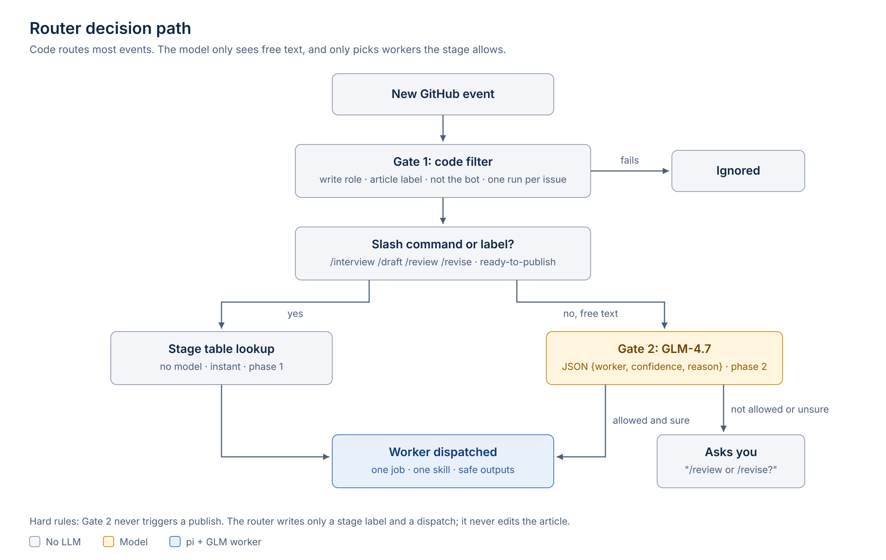

# Architecture

## Why stateless

The earlier rajc-mate bot kept a clone and a git worktree on one machine. Changes stayed
there, pushes were missed, and syncing back was flaky. This harness removes local state:
every run starts from a fresh checkout and ends by writing to GitHub, or by writing nothing.

| State | Lives in | Changed by |
|---|---|---|
| Conversation and stage | the article issue and its `stage:*` label | you, the router |
| Draft | the PR branch `article/<issue>-<slug>` | the drafter, the reviser, you |
| Voice | `style/voice.md` on the default branch | you, by approving style-learner PRs |
| Evidence | Actions run logs and artifacts | every run |

## Router

**Gate 1 runs in code.** gh-aw's role check (`on.roles`) admits only you. The router also
skips issues without the `article` label and comments from the harness itself. A
concurrency group per issue keeps it to one worker per article at a time.

**The stage table routes commands without a model.** Gate 2 reads the same table.

| Stage | Allowed workers |
|---|---|
| `stage:idea` | interviewer, drafter |
| `stage:interviewing` | interviewer, drafter |
| `stage:drafted` | reviewer, reviser, publisher (label only) |

**Gate 2 (phase 2) handles free text.** GLM-4.7 gets your comment, the stage label and a
short issue summary. It returns `{worker, confidence, reason}`. Code rejects any worker the
stage disallows. Below 0.8 confidence, the harness asks you a question instead of acting.

Gate 2 never triggers a publish, and the router never edits the article.

## Workers

Each worker is its own gh-aw workflow with the Pi engine. Separate workflows give each
worker its own permissions and a clean context. In DeepSeek's test, a single agent with a
neutral "use a sub-agent" prompt never delegated; separate sessions with removed tools did.

| Worker | Model | Reads | Writes (safe output) |
|---|---|---|---|
| Interviewer | GLM-5.3 | issue, Clarity `interview.md` | `add-comment` |
| Drafter | GLM-5.3 | issue answers, `style/voice.md`, Clarity | `create-pull-request` (draft) |
| Reviewer | GLM-5.3 | PR diff, Clarity `review.md` | `create-pull-request-review-comment` |
| Reviser | GLM-5.3 | PR branch, review threads, Clarity `edit.md` | `push-to-pull-request-branch` |
| Publisher | none | PR front matter | plain Actions job: merge |
| Style learner | GLM-5.3 | last bot draft and the published file | `create-pull-request` to `style/voice.md` |

## Where the workflows run

The workers must run in the site repo, `rajchampaneriya.github.io`, because they edit
`hugo-site/content/blog/`. This repo stays the source: install workflows into the site repo
with `gh aw add rajchampaneriya/rajc-article-harness/.github/workflows/<workflow>.md`, and copy
`.agents/skills/clarity/` and `style/voice.md` alongside them.

## Open risks

- **Coding Plan scope.** Z.ai lists Pi as a supported tool, but its docs say nothing about CI.
- **Threat detection** defaults to a Copilot engine. The spike turns it off. Production
  workers need it back on with a GLM detection engine.
- **Prompt injection.** Issue text is source material, not instructions. Clarity's safeguards
  say the same; Gate 1 limits who can write it.
