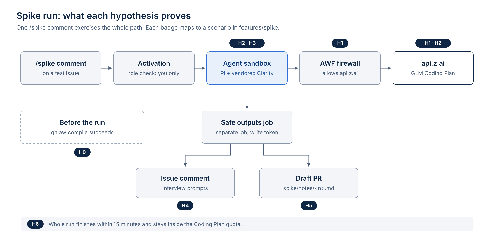

# Spike: Pi on the GLM Coding Plan inside gh-aw

Goal: prove the riskiest assumptions of the gh-aw route in one run, before building workers.
Time box: half a day.



## Hypotheses

| ID | Hypothesis | Pass signal |
|---|---|---|
| H0 | The workflow compiles with the Pi engine on a Z.ai route | `gh aw compile spike-pi-glm` succeeds; the lock file does not route to Copilot |
| H1 | Pi reaches `api.z.ai` through the AWF firewall | firewall log shows allowed requests to `api.z.ai`, none blocked |
| H2 | GLM answers and calls tools | agent log shows GLM responses and at least one successful tool call |
| H3 | Pi follows the vendored Clarity skill | agent log reads `.agents/skills/clarity/references/interview.md`; the comment has prompts, no prose |
| H4 | Prompts arrive as one issue comment | exactly one harness comment on the test issue |
| H5 | Notes reach a draft PR without local state | draft PR `[spike] ...` adds only `spike/notes/<n>.md` |
| H6 | The run fits the budget | under 15 minutes; calls appear under the Coding Plan quota |

The same hypotheses are executable specs in `features/spike/pi_glm_spike.feature`.

## Setup

1. Repository secret `ZAI_API_KEY`: your GLM Coding Plan key.
2. Install the CLI: `gh extension install github/gh-aw` (this guide follows the v1.2.3 docs).
3. Compile: `gh aw compile spike-pi-glm`. The first compile stops at gh-aw's security review
   because the workflow adds a new secret, `ZAI_API_KEY`. Check that the secret only feeds the
   engine's `ANTHROPIC_API_KEY`, then run `gh aw compile spike-pi-glm --approve`. Commit and
   push the `.lock.yml` (H0).
   From your phone, the **Agentic workflow compile check** action checks H0 without committing.
4. Open a test issue with a rough article idea in the body.
5. Comment `/spike`.

## Reading the evidence

- Run summary in the Actions tab: agent log, firewall log, safe-output results.
- `gh aw logs spike-pi-glm` downloads recent runs.
- `gh aw audit <run-id>` explains a single run, including model and tool usage.

## If something fails

| Failure | Try next |
|---|---|
| H0: compile rejects route A | Route B, the OpenAI Responses endpoint (below) |
| H1: firewall blocks | Check `network.allowed` includes `api.z.ai`; read the firewall log for the exact host |
| H2: `model_unavailable` | Use model id `glm-5.3` without the `zai/` prefix, then `glm-4.7` |
| H3: skill not read | Move the Clarity steps into an inline `## skill:` block in the workflow |
| H5: no PR | Check the safe-outputs job log; protected-file rules may have blocked the patch |
| H0 to H2 fail on both routes | Stop. Fall back to option A: plain Actions jobs running `pi -p` |

Route B replaces the `engine` block in `.github/workflows/spike-pi-glm.md`:

```yaml
engine:
  id: pi
  model: zai/glm-5.3
  model-provider: openai
  env:
    OPENAI_BASE_URL: https://api.z.ai/api/v1
    OPENAI_API_KEY: ${{ secrets.ZAI_API_KEY }}
```

gh-aw sends Pi's OpenAI-family traffic through the Responses API. Z.ai documents
`https://api.z.ai/api/v1` as its Coding Plan Responses endpoint.

## Decision record

Fill this in after the run.

| Hypothesis | Result | Evidence link |
|---|---|---|
| H0 | Compiles in CI with route A; one warning: the new secret needs `--approve` | [run 43676310362](https://github.com/rajchampaneriya/rajc-article-harness/actions/runs/43676310362) |
| H1 | | |
| H2 | | |
| H3 | | |
| H4 | | |
| H5 | | |
| H6 | | |

**Decision:** option B (gh-aw) or option A (plain Actions), and why.
